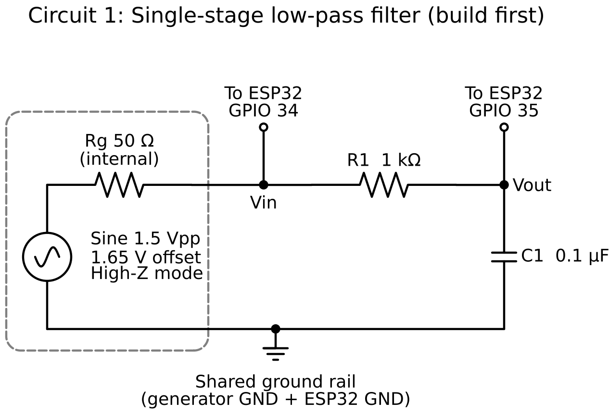
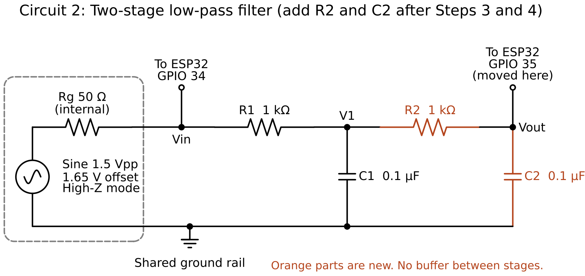
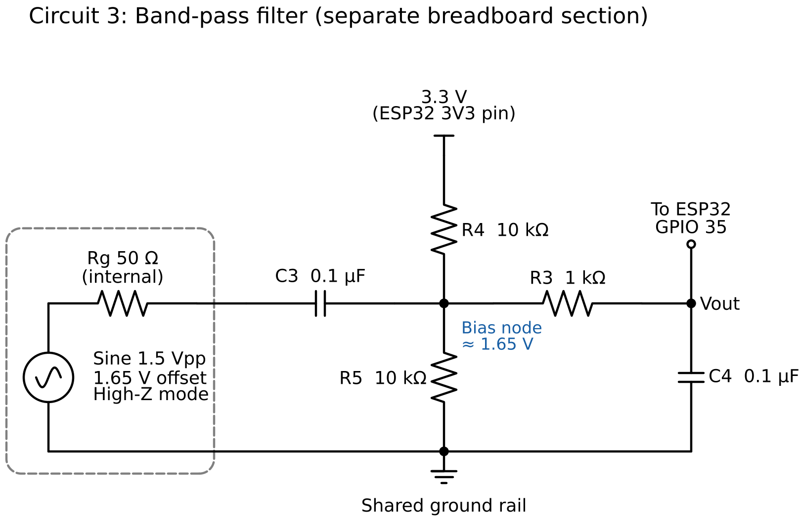
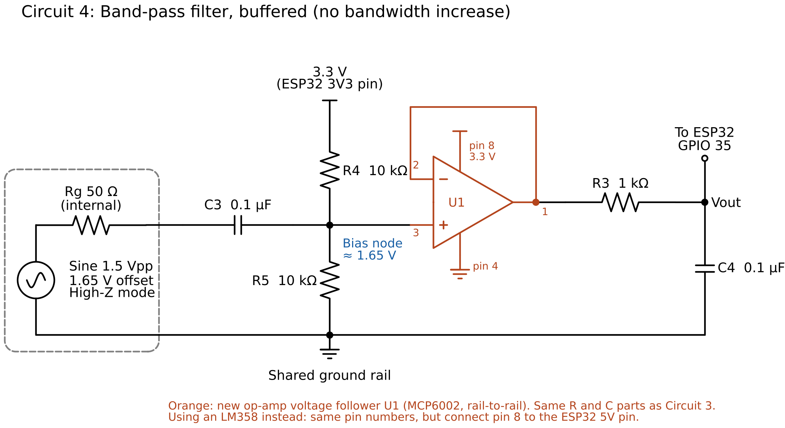

# Loading and Bandwidth in Cascaded RC Filters

Physics 4BL final project at UCLA (Fall 2026, Lab 2, Table 7) by Min-En Wu, Ryan Elshoff and Jacob Chapman.

When one RC stage drives another without a buffer, the second stage draws current from the first, so the combined response is no longer the product of the two single-stage responses. This project measures how that loading changes a two-pole RC band-pass filter. We compared the loaded filter with the same parts separated by an op-amp voltage follower, recorded frequency sweeps, two-channel phase points and 500 Hz square waves with an ESP32, and compared every measurement with Monte Carlo predictions from the measured component values.

**Main result.** Loading widened the half-power bandwidth from 2023 ± 2 Hz to 3399 ± 5 Hz (predicted 1935 ± 35 Hz and 3368 ± 51 Hz) while the center frequency stayed near 700 Hz. The extra bandwidth came entirely from a lower peak: the peak power ratio fell from 0.649 to 0.207, and the loaded response stayed at or below the buffered response at every measured frequency.

The full write-up is in [Physics 4BL Final Report.docx](Physics%204BL%20Final%20Report.docx), and the slides are in [Physics 4BL Final Presentation_Table 7.pptx](Physics%204BL%20Final%20Presentation_Table%207.pptx).

## Key findings

* Loading widened the bandwidth by a factor of 1.680 ± 0.003 (predicted 1.74) and lowered Q from 0.364 to 0.206.
* The product (K/b)·Δf stayed between 1.5 and 1.7 kHz in both forms, so the bandwidth gained was paid for in peak gain.
* The loaded filter passes the harmonics of a 500 Hz square wave more evenly (0.96, 0.85 and 0.74 of the fundamental for harmonics 3, 5 and 7, against 0.90, 0.67 and 0.52 for the buffered filter). The buffered filter passes more of every harmonic in absolute terms.
* The two-stage low-pass filter shows the same loading term from the other side. Its fitted b excludes the unloaded model by 32σ, and its half-power frequency is 593 Hz rather than 1015 Hz.
* Overall, 42 of 58 comparisons agree within 2σ, including 23 of 24 for the loaded band-pass filter. The main disagreements are listed under [Open issues](#open-issues).

## Circuits

| Circuit 1: single-stage low-pass (control) | Circuit 2: two-stage low-pass, unbuffered |
|---|---|
|  |  |
| **Circuit 3: band-pass, loaded** | **Circuit 4: band-pass, buffered** |
|  |  |

All four circuits use the same parts, measured with a multimeter. Same-type parts read identical values:

| Part | Nominal | Measured |
|---|---|---|
| R1, R2, R3 | 1 kΩ | 0.987 kΩ |
| R4, R5 | 10 kΩ | 9.97 kΩ |
| C1 to C4 | 0.1 µF | 99.7 nF |
| Generator output resistance Rg | 50 Ω | not measured |

The band-pass filter was built once with the MCP6002 follower wired beside it. Moving only the input end of R3 from the bias node to the follower output switches it from loaded (Circuit 3) to buffered (Circuit 4) without changing any R or C.

## Theory

The band-pass filter is a high-pass stage (C3 into the bias divider R4 and R5) followed by a low-pass stage (R3 and C4). Its power ratio is

```math
\frac{P}{P_0} = \frac{(K\omega)^2}{\left(1 - c\,\omega^2\right)^2 + \left(b\,\omega\right)^2}
```

with

```math
K = R_B C_3, \qquad b = R_B C_3 + R_3 C_4 + \underbrace{R_B C_4}_{\text{loaded only}}, \qquad c = R_B C_3 R_3 C_4, \qquad R_B = \frac{R_4 R_5}{R_4 + R_5}
```

The center frequency, bandwidth and quality factor follow from b and c:

```math
f_0 = \frac{1}{2\pi\sqrt{c}}, \qquad \Delta f = \frac{b}{2\pi c}, \qquad Q = \frac{\sqrt{c}}{b}, \qquad \frac{K}{b}\,\Delta f = \frac{1}{2\pi R_3 C_4}
```

Loading adds the term $`R_B C_4`$ to b but leaves K and c unchanged, so it widens Δf and lowers Q at a fixed f₀. The last relation depends only on the second stage, so any bandwidth gained must be paid for in peak gain. The analysis also includes the generator's 50 Ω output resistance, which adds a small extra term to c (see `rcfilter.py`).

The two-stage low-pass filter has the same structure:

```math
\frac{P}{P_0} = \frac{1}{\left(1 - c\,\omega^2\right)^2 + \left(b\,\omega\right)^2}, \qquad b = R_1 C_1 + R_2 C_2 + \underbrace{R_1 C_2}_{\text{loaded only}}, \qquad c = R_1 C_1 R_2 C_2
```

## Method

**Equipment.** A Rigol DG1022 function generator in High-Z mode supplied the signals. An ESP32 Dev Module recorded the circuit's input terminal on GPIO 34 and its output on GPIO 35 with its 12-bit ADC. The data were recorded with `daq.py` and analyzed in Python with NumPy and SciPy.

**Measurements.** The recording session followed [data recording procedure.docx](data%20recording%20procedure.docx) and included four kinds of measurement:

1. ESP32 calibration with both pins on the generator: sampling rate, delay between the two channels, ADC linearity from a 1 Hz triangle wave, DC noise, and the reference sweep.
2. Linear frequency sweeps from 20 Hz to 10 kHz over 20 s for every circuit. Each recording lasts 85 s, so it contains three complete sweeps.
3. Two-channel phase points at nine frequencies from 100 Hz to 5 kHz for Circuits 1, 3 and 4.
4. Three bursts of a 500 Hz square wave through each band-pass form.

**Comparison.** Each prediction comes from 10,000 Monte Carlo draws of the component values within the multimeter's accuracy bound. A measurement agrees with its prediction when |z| < 2, where

```math
z = \frac{x_{\text{meas}} - x_{\text{pred}}}{\sqrt{\sigma_{\text{meas}}^2 + \sigma_{\text{pred}}^2}}
```

## Results

| Quantity | Measured | Predicted | z |
|---|---|---|---|
| Bandwidth Δf, buffered | 2022.9 ± 2.3 Hz | 1935 ± 35 Hz | +2.5 |
| Bandwidth Δf, loaded | 3399 ± 5 Hz | 3368 ± 51 Hz | +0.6 |
| Center frequency f₀, buffered | 736.7 ± 0.7 Hz | 716 ± 11 Hz | +1.9 |
| Center frequency f₀, loaded | 699.8 ± 1.0 Hz | 699 ± 10 Hz | +0.1 |
| Q, buffered | 0.3642 ± 0.0005 | 0.370 ± 0.004 | −1.6 |
| Q, loaded | 0.2059 ± 0.0004 | 0.2075 ± 0.0006 | −2.1 |
| Peak power ratio, buffered | 0.649 ± 0.004 | 0.685 ± 0.007 | −4.7 |
| Peak power ratio, loaded | 0.2070 ± 0.0012 | 0.205 ± 0.006 | +0.3 |
| (K/b)·Δf, buffered | 1630 ± 5 Hz | 1602 ± 34 Hz | +0.8 |
| (K/b)·Δf, loaded | 1546 ± 5 Hz | 1526 ± 32 Hz | +0.6 |
| Two-stage b against the loaded model | 2.991 ± 0.004 × 10⁻⁴ s | 3.05 ± 0.05 × 10⁻⁴ s | −1.3 |
| Two-stage b against the ideal model | 2.991 ± 0.004 × 10⁻⁴ s | 2.02 ± 0.03 × 10⁻⁴ s | +32.1 |
| Two-stage half-power frequency | 592.8 ± 1.0 Hz | 584 ± 9 Hz | +0.9 |
| Single-stage cutoff, sweep | 1063.8 ± 2.0 Hz | 1540 ± 32 Hz | −14.7 |
| Single-stage cutoff, phase | 1133 ± 9 Hz | 1618 ± 34 Hz | −13.8 |
| Generator resistance Rg | 64 ± 8 Ω | 50.0 ± 0.6 Ω | +1.7 |

The row "two-stage b against the ideal model" is meant to fail, because that failure is the evidence of loading. All 58 comparisons are listed in Appendix A of the report.

## Open issues

* **Single-stage control.** Circuit 1 cut off near 1.06 kHz instead of 1.54 kHz in both the sweep and the phase measurement. Its time constant was about 45 % above R1C1, so the circuit as recorded most likely differed from the diagram, for example through an extra capacitance of about 43 nF at the output. The two-stage filter built from the same first stage does not show this error.
* **Buffered form.** Circuit 4 ran about 3 % high in frequency and 3 % low in gain in all three methods, so the change in c from loading was 10.8 % instead of the predicted 5 %. A follower gain slightly below 1, or a change in R3 or C4 when R3 was moved, could explain this.
* **Low frequencies.** The planned comparison at 20 Hz could not be made, because a linear sweep spends too little time at low frequency to measure below about 50 Hz.

## Notes on the data

These points matter for anyone who reuses the recordings:

* **Sampling rates.** The ESP32 could not hold the requested timer periods (25 µs for streams, 49 µs per pair for bursts), because each `analogRead` took about 39 µs. The real rates were 11.55 to 11.85 kS/s for streams and 11.93 to 12.62 kS/s per channel for bursts. The `period_us` value in each file's header is the requested period, not the real one, so every file's rate was calibrated from its own known signal frequency. Sweep fits therefore stop at 4.6 kHz.
* **Sweeps.** The sweeps are linear, not logarithmic. The generator's true sweep period was 20.075 s (497.12 Hz/s).
* **Bursts.** The pair rate shifts by about 0.1 % partway through each burst, so bursts were analyzed in windows of 1000 pairs (82 ms). The delay between the two channels was 39.02 ± 0.01 µs.
* **Generator amplitude.** The amplitude differed by up to 5.4 % between recording blocks, so each sweep was corrected with the input amplitude measured in the same block.

**File format.** Every CSV begins with `# key=value` metadata lines, then a header line (`ch35` for streams, `ch34,ch35` for bursts), then one row of raw 12-bit ADC counts per sample. File names use `ref` for the generator connected directly, `lp1` for Circuit 1, `lp2` for Circuit 2, `bpL` for Circuit 3 (loaded) and `bpB` for Circuit 4 (buffered).

## Repository layout

```
individual-screws/
├── README.md
├── Physics 4BL Final Report.docx                # full report, all comparisons, analysis code listing
├── Physics 4BL Final Presentation_Table 7.pptx  # final presentation
├── Cascaded_RC_Filter_Proposal_v2.pdf           # proposal and hypothesis
├── data recording procedure.docx                # recording session, blocks A to E
├── 1_single_stage_lowpass.png                   # circuit diagrams 1 to 4
├── 2_two_stage_lowpass.png
├── 3_bandpass.png
├── 4_bandpass_buffered.png
├── predicted vs measured components.PNG         # nominal and measured part values
├── example success outcome/                     # Figures A and B from simulated data, made before recording
├── waveform generator setup/                    # photos of the generator setup
└── rc_filter_code/
    ├── README.md                                # wiring, recording commands, design notes
    ├── rc_daq/rc_daq.ino                        # ESP32 firmware
    ├── daq.py                                   # records from the ESP32 straight to CSV
    ├── rcfilter.py                              # analysis library: models, Monte Carlo, fits, z-scores
    ├── analysis.ipynb                           # analysis pipeline as planned in the proposal
    ├── simulate_data.py                         # synthetic data set for testing the pipeline
    └── data/
        ├── calib/                               # sampling rate, channel delay, linearity, noise
        ├── sweeps/                              # ref, lp1, lp2, bpL, bpB
        ├── phase/                               # nine frequencies each for lp1, bpL, bpB
        └── square/                              # three 500 Hz bursts each for bpL and bpB
```

## Running the code

1. Install Python 3 and the packages:

   ```bash
   pip install numpy scipy pandas matplotlib pyserial jupyter
   ```

2. Test the analysis pipeline on simulated data:

   ```bash
   cd rc_filter_code
   python simulate_data.py
   jupyter notebook analysis.ipynb
   ```

   Keep `DATA = Path("data_sim")` and run all cells. The notebook ends with the full comparison table.

3. **Final numbers.** `analysis.ipynb` is the pipeline as planned, which assumes logarithmic sweeps and the requested sampling rates. The recorded data needed the adjustments described in [Notes on the data](#notes-on-the-data), so the numbers in this README and in the report come from `analysis.py`, which is listed in full in Appendix B of the report.

4. **Recording new data.** Upload `rc_filter_code/rc_daq/rc_daq.ino` with the Arduino IDE (board "ESP32 Dev Module"), then follow the recording procedure. Request a sampling period the ADC can hold, for example 100 µs, so that the rate corrections are not needed. [rc_filter_code/README.md](rc_filter_code/README.md) lists every recording command.

## Acknowledgments

The sweep, calibration and fitting approach builds on the UCLA Physics 4BL Unit 3 course code and slides. Claude (Anthropic) assisted with the analysis code, the data analysis and the report, as noted in the report's references.
